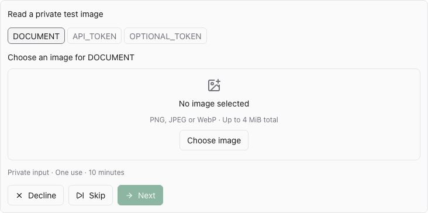
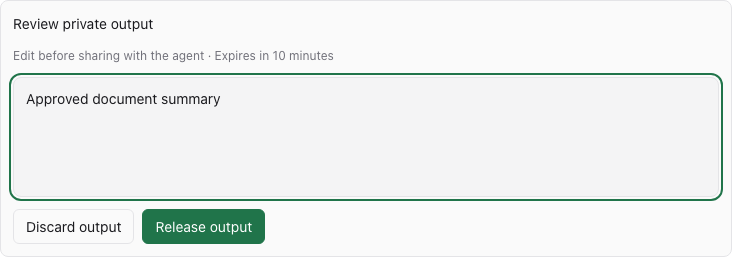

# Paseo Secrets

See [OVERVIEW.md](OVERVIEW.md) for behavior, requirements, and security limits.

Requires Paseo 0.11.2 or later, a macOS or Linux daemon, and npm on the daemon host. Enable trusted plugins in Paseo, then install the Git release:

```sh
paseo plugin install git:yuruiz/paseo-plugins:secrets
```

The private-input workflow exposes these MCP tools:

- `request_secrets({ agentId, purpose, fields })`: open a private input card in the current conversation. Read `PASEO_AGENT_ID` from the agent environment for the ID. Each field has an uppercase `name` and `kind: "text" | "image"`. The tool returns pending immediately; the agent should finish its turn and wait for the user's submission notification.
- `run_with_secrets({ grantId, executable, args })`: consume one grant. Text is injected as environment values; images are injected as temporary file paths. Grants containing images return status and an `outputId` with empty stdout/stderr.
- `read_secret_output({ outputId })`: read explicitly released text. Before approval it returns only `awaiting_review`. The user's release sends a notification; do not poll while waiting.

Select **Secrets** in the composer to browse the saved Connect connection’s secret list. The first accessible vault loads automatically; select another vault or filter by title. Select **Provide secrets** to create a grant manually or review pending requests and held output. `/secrets` or **Provide secrets** in the Command Center adds an inline form. **Send to agent** delivers metadata only. For image output, review and edit in the conversation, then release or discard it. The Secrets popover also lists pending requests and held output if a timeline card is unavailable. Requests follow the app question card interaction: one field at a time, tabs with completion checks, Next, and a final submit. The plugin matches this presentation with the available host primitives; it does not call the permission-bound QuestionFormCard or its answer transport. Raw values, original filenames, image bytes and unreleased output are never included in plugin timeline rows.

The plugin hosts an official-SDK Streamable HTTP MCP server bound to `127.0.0.1`. It exposes the private-input tools above and the Connect tools below, with no raw-input or grant-listing MCP tool. Output reading is gated by the separate client approval RPC. The grant ID authorizes one execution; keep it private. Browser-origin requests are rejected. This local endpoint does not replace the existing app-to-daemon connection used to submit secrets. The port is saved in `$PASEO_HOME/plugin-state/secrets-mcp/endpoint.json` so configurations remain valid after reload. That file contains no credentials. An occupied saved port fails explicitly rather than silently changing the endpoint.

New Codex, Claude, OpenCode, and Copilot agents automatically receive the `paseo-secrets` MCP configuration. Internal agents and other providers are left unchanged. Existing agents need the endpoint added through their provider's MCP configuration and their session reloaded. Reloading an agent that predates plugin installation does not run the creation hook and cannot add a missing MCP entry by itself. The current plugin API cannot hot-add tools to an already-running session. Other MCP-capable providers can configure the same local endpoint manually. Do not expose this endpoint on the network.

For supported providers, the plugin appends `127.0.0.1`, `localhost` and `::1` to both `NO_PROXY` and `no_proxy` when an interactive session opens (create, resume, refresh or import). Existing exclusions from the inherited, provider and session environments are preserved. This keeps the agent’s local MCP connection out of HTTP/SOCKS proxies while Connect’s outbound requests continue using the saved Connect proxy. Running sessions need a reload to receive the updated environment.

For an existing Codex setup, register the local endpoint once using `codex mcp add paseo-secrets --url http://127.0.0.1:PORT/mcp`, replacing `PORT` with the saved port. Then reload the agent session. Clients with a tool timeout below two minutes may cancel execution earlier; increase that client's MCP tool timeout when longer commands are needed.

Once admitted, the grant is consumed before spawning, including when the executable cannot start. Capacity rejections leave it pending. Revoking a pending grant does not stop a command that has already claimed it. For an explicit shell command, pass `sh` with `args: ["-c", "…"]`; do not expand secret values in the agent's own shell.

The child process inherits only `PATH`, `HOME`, `USER`, `LOGNAME`, `SHELL`, `LANG`, `LC_ALL`, and `TMPDIR`, then adds the supplied variables. It does not inherit provider tokens or other environment variables from the daemon. Programs still have the daemon user's filesystem and network access. On command exit, timeout, client disconnect, or orderly plugin shutdown, the broker kills its process group. A deliberately detached process can escape this lifecycle, and a broker crash can leave a running command behind; this is not a process sandbox.

The plugin stores no private input or unreleased output in settings, drafts, timeline rows, or query/mutation caches. Image files are the exception to memory-only handling during consumption: the broker uses a private directory and owner-only files under its image directory. It removes them after completion, failure or cancellation. An inline form's timeline row contains only a request ID; its input values stay in the mounted client's form. Input values are cleared when submission begins, and a failure requires re-entry. If the host remounts a form during a layout or theme change, enter its values again; private drafts are not cached outside the mounted form. Check the pending-grant list before retrying an uncertain submission. Managed-runtime strings cannot be securely zeroed, and host memory, swap, and crash dumps are outside this guarantee.





## 1Password Connect

Open **Settings → Plugins → Secrets → ⋯ → 1Password Connect** on the target host, enter the Connect server URL and access token, then select **Save and enable**. Configuration loads automatically after plugin reload or daemon restart. To replace it, enter the URL and a new token; the screen never retrieves the saved token.

If the daemon reaches Connect through a proxy, set **Connect proxy URL**. Supported schemes are `http://`, `https://`, `socks5://` (daemon-side DNS) and `socks5h://` (proxy-side DNS); proxy authentication and URL paths are not supported. For a Tailscale userspace proxy listening on the daemon host at port 1055, use `socks5h://127.0.0.1:1055` or `http://127.0.0.1:1055`. **Save proxy** updates the proxy without re-entering the Connect token or changing agent access. Leave it blank to use a direct connection.

The explicit proxy applies to connection tests, client vault/item browsing and all Connect MCP tools. It does not change the daemon's global proxy settings, use ambient proxy environment variables, or fall back to direct access if the proxy fails. HTTPS still validates certificates, and redirects remain rejected. Saving a proxy cancels outstanding Connect requests. Older saved configurations without a proxy field continue to connect directly. See [Tailscale userspace networking](https://tailscale.com/docs/concepts/userspace-networking) for the proxy setup.

**Test saved connection** authenticates against the vault-list endpoint and reports only the vault count. It does not test write permissions, save draft changes, or enable disabled access. **Disable access** blocks the Connect MCP tools while retaining the credentials; **Enable access** resumes without re-entering them. **Delete saved configuration** removes the saved URL and token. Disabling, replacing or deleting configuration cancels outstanding Connect requests. It cannot undo a write already accepted by the Connect server.

Use the **Secrets** composer pill or **Browse Connect items** on the same settings screen to select a vault and see its items. The compact list shows item titles and categories, with vault selection, title search and a single Refresh action above it. Show more loads beyond the first 50 matches. Each item in the composer popover has a **Share with agent** button. This reads the item on the daemon, converts non-empty text fields to environment variables, and creates the same ten-minute, one-use grant as manual secret submission. Field labels become uppercase variable names, with numeric suffixes for duplicates. The current agent receives only the grant ID, field names and `run_with_secrets` instructions. Secret values stay in the broker, outside the conversation and client cache. A failed send revokes the newly created grant. Sharing requires enabled agent access and the existing grant limits apply (32 fields, 16 KiB per value). Empty vaults, no matches and request errors have distinct states. Browsing remains available while agent access is disabled and never enables it.

Client browsing calls the saved Connect server from the daemon. It uses list endpoints only and strips fields outside the displayed metadata before returning results to the client. Listing does not fetch item details or secret field values; only an explicit **Share with agent** action reads the selected item into a private grant. Metadata is held only while browsing and cleared when leaving, switching vaults, or applying configuration actions.

The daemon stores URL, token, proxy URL and enabled state in `$PASEO_HOME/plugin-state/secrets-mcp/connect/configuration.json`. When `PASEO_HOME` is unset, it uses the daemon user’s `~/.paseo`, matching Paseo’s default. Explicit paths, including `~/…` and relative paths, use Paseo’s home resolution rules. The directory uses `0700` and the file uses `0600`. Saves use a private temporary file and atomic replacement; failed saves leave the active configuration unchanged. Corrupt or unreadable configuration disables Connect and appears as an error in Settings, where you can replace or delete it. This file is separate from ordinary plugin Settings, which authorized clients can read.

The file is plaintext: the daemon user, same-user agents, administrators and backups can read it. It survives plugin removal because it lives outside the plugin source directory; use **Delete saved configuration** before uninstalling if you want it removed. A process crash during saving can leave a private temporary file in the same directory. Deleting a configuration does not revoke the token in 1Password or erase backups. Use the 1Password administration controls to revoke a token.

Agents connected to this host's Secrets MCP can use:

| Tool                       | Operation                                                     |
| -------------------------- | ------------------------------------------------------------- |
| `onepassword_list_vaults`  | List vaults allowed by the token.                             |
| `onepassword_list_items`   | List metadata for `vaultId`, optionally with a SCIM `filter`. |
| `onepassword_get_item`     | Read `vaultId` / `itemId`, including field values.            |
| `onepassword_create_item`  | Create `item` in `vaultId`.                                   |
| `onepassword_replace_item` | Replace the complete `item` at `vaultId` / `itemId`.          |

Write inputs follow the [Connect FullItem API](https://developer.1password.com/docs/connect/api-reference/): supply `title`, `category`, and the desired `fields`, `sections`, `tags`, and `urls`. Read before replacing and preserve fields you want to keep. The selected vault and item IDs override IDs in the submitted object. List filters support `title eq "name"` or `tag eq "tag"`.

Connect access uses the token's permissions. It is shared by callers of this host's local MCP endpoint, without a separate per-agent grant. **Read and write results include field values in agent context.** The private-input workflow above continues to keep supplied values out of normal tool results. Use a Connect token scoped to the vaults and write permissions you intend agents to access.

Connect requests have a 30-second deadline and a 2 MiB response limit. Redirects are rejected. Errors return status or connectivity guidance without upstream response bodies or the token. The token is entered in the UI for saving, but never returned by status or test RPCs, or stored in timeline rows, query/mutation caches or the MCP endpoint file. Use HTTPS for a remote Connect server.

## Development

Install development dependencies and run the standalone checks:

```sh
npm ci --ignore-scripts
npm run typecheck
npm run lint
npm run format:check
npm test
```

The test file exercises the real local MCP server, disposable child processes, private image cleanup, output review, form/Skip behavior, and Connect HTTP requests against a local fixture. Connect persistence tests cover restart recovery, owner-only permissions, failed saves, damaged configuration, serialized writes, disable/enable, deletion and client metadata-only browsing, HTTP/SOCKS proxy routing, proxy-side DNS, cancellation and TLS certificate rejection. These tests do not access a live 1Password account. CI runs it on macOS and Linux with Node 22. The source was extracted from the Paseo monorepo after plugin lifecycle and browser flows were verified there; those host integration tests remain in Paseo.

To develop against this checkout:

```sh
paseo plugin install /absolute/path/to/paseo-plugins/secrets
```

Reload installed source changes with `paseo plugin reload secrets`. Reloading drops pending requests, grants and held output. Reload existing agent sessions afterward to refresh their tool inventory.
